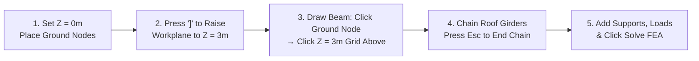

# Beam3D Tutorials — Basic Operations & Drawing in 3D

> **Interactive In-App Coach:** You can also follow interactive, live-checked tutorials directly inside the desktop app! Click **`🎓 Tutorials`** in the top toolbar to launch any of the 4 guided tracks.

---

## Coordinate System & Units

Beam3D uses a right-handed **Z-up** structural engineering coordinate system:

- **Ground Plane (`X–Y`):** Horizontal floor/plan axes (`+X` right, `+Y` into screen in Front view).
- **Vertical Axis (`+Z`):** Elevation pointing straight up (`Z = 0 m` is default ground level; gravity acts along `-Z`).
- **Member Local Axes (`x, y, z`):**
  - Local `x` runs from `Node i` → `Node j`.
  - Local `z` points upward (web depth direction `h`) for horizontal girders when `Roll γ = 0°`, so **strong-axis bending (`My`, inertia `Iy`)** resists vertical gravity loads.
  - Local `y` is the flange width direction `b` (**weak-axis bending `Mz`, inertia `Iz`**).

| Quantity | UI Display Unit | JSON Storage Unit (SI) |
|---|---|---|
| Coordinates / Length | `m` | `m` |
| Cross-Section Dimensions | `mm` | `m` |
| Forces / Distributed Loads | `kN`, `kN/m` | `N`, `N/m` |
| Moments / Torque | `kN·m` | `N·m` |
| Displacements / Rotations | `mm`, `mrad` | `m`, `rad` |
| Stress / Moduli | `MPa`, `GPa` | `Pa` |

---

## Tutorial 1: How to Draw in 3D (Build a Space Frame from Scratch)

Because a computer screen is 2D, 3D structural CAD tools combine **two mechanisms** to place points accurately in 3D space:
1. **Adjustable Horizontal Workplane (`Z`) + Grid Snap:** Unsnapped clicks land on the horizontal construction grid at elevation `Z = Workplane Z`, rounded to `Snap` increments.
2. **3D Magnetic Node Snapping:** Hovering near *any* existing node (at any `Z` elevation!) magnetically snaps your cursor to that 3D node (`Snap → Node N#`), overriding the workplane.

### Step-by-Step: Drawing a 4 m × 4 m × 3 m Steel Canopy

1. **Start a Clean Workspace**
   - Click **`📂 Templates...` → `✨ New Empty Model`**.
   - Check **`Labels`** in the Right Panel (`🎨 3D Post-Processor & View`) so `N1`, `N2`, ... are visible in 3D.

2. **Place the 4 Column Base Nodes at Ground (`Z = 0 m`)**
   - Click **`⊕ Add Node`** in the top toolbar.
   - Notice the blue **3D Drawing HUD** appears at the top-right of the viewport showing your live snapped `XYZ` coordinates.
   - Set **`Snap: 1.0 m`** and ensure **`Workplane Z: 0m`** is active.
   - Left-click four corners on the grid:
     - `(0, 0, 0)` → creates `N1`
     - `(4, 0, 0)` → creates `N2`
     - `(4, 4, 0)` → creates `N3`
     - `(0, 4, 0)` → creates `N4`
   - *(Tip: **Right-drag** anytime to orbit the 3D camera without placing a node!)*

3. **Raise the 3D Workplane to Roof Level (`Z = 3.0 m`)**
   - Press **`]`** three times on your keyboard (or click **`3m`** in the top-right 3D Drawing HUD).
   - Watch the 3D grid physically rise to `Z = 3.0 m`!
   - Move your cursor around the viewport: notice the cyan **vertical plumb-line** dropping from your elevated `(X, Y, 3.0)` cursor down to `Z = 0` so you can line up directly above ground nodes.

4. **Draw Vertical Columns & Chain Roof Girders**
   - Click **`📏 Draw Beam`** in the top toolbar:
     1. Hover over ground node **`N1`** `(0, 0, 0)` — the HUD reads `Snap → Node N1` — and **Left-click**.
     2. Move straight up to `(0, 0, 3.0)` on the elevated grid (watch the vertical plumb-line touch `N1`!) and **Left-click** → **Column `B1` (`N1 → N5`) is created!**
     3. Because **`Draw Beam` automatically chains**, your start node is now `N5` `(0, 0, 3)`. Click `(4, 0, 3)`, then `(4, 4, 3)`, then `(0, 4, 3)`, then click **`N5`** again to close the entire 4-girder roof perimeter in four clicks!
     4. Press **`Esc`** (or **Right-click**, or click **`End Chain`** in the HUD) to stop chaining.
     5. Connect the remaining three vertical columns (`N2 → N6`, `N3 → N7`, `N4 → N8`), pressing `Esc` after each column.

   > **Shortcut — One-Click Column Extrusion:** Instead of raising the workplane manually, you can also select any ground node with **`🖱 Select`**, set **`ΔZ: 3.0 m`** in the Right Panel (`Selection Inspector`), and click **`⬆ Extrude Column (+ΔZ)`** to create the upper node and vertical column in a single click!

   > **Exact Coordinate Entry:** Prefer typing exact numbers? Open the **`🏗 Structure`** tab in the Left Panel, enter `X, Y, Z`, click **`+ Add Node at Coordinates`**, and connect any two nodes via **`+ Connect`**.

---

## Tutorial 2: Assigning Supports & Prescribed Settlements

A 3D frame without supports is a rigid-body mechanism and cannot be solved until restrained.

1. Switch to **`🖱 Select`** (or press `Esc`).
2. Click ground node **`N1`** in the 3D viewport.
3. In the Right Panel (**`Selection Inspector`**), open the **`Support`** dropdown:
   - **`Fixed (All 6 DOFs)`** — restrains translations `ux, uy, uz` and rotations `rx, ry, rz` (renders a 3D teal base block).
   - **`Pinned (ux, uy, uz)`** — restrains translations only, allowing free rotation (renders a 3D green pyramid).
   - **`Vertical Roller (uz)`** — restrains vertical translation `uz` only (renders a 3D blue pyramid on a roller plate).
   - **`Custom`** — toggle individual checkboxes (`ux`, `uy`, `uz`, `rx`, `ry`, `rz`).
4. Repeat for `N2`, `N3`, and `N4`.
5. *(Optional — Support Settlement)* Expand **`Prescribed Settlement / Rotation`** on a supported node and enter e.g. `uz = -0.010 m` (`-10 mm`) to simulate foundation differential settlement!

---

## Tutorial 3: Cross-Sections, Materials & Roll Angle ($\gamma$)

### Editing or Creating Parametric Sections
1. Open the **`📐 Sections & Mat`** tab in the Left Panel.
2. Click **`+ New`** or edit an existing section:
   - Choose from **I / H Wide-Flange**, **Hollow Rectangular (HSS)**, **Circular Pipe / Tube**, **Solid Rectangular**, **Solid Circular Rod**, or **Custom Properties**.
   - Drag dimensions in **`mm`** — the **2D blueprint cross-section preview**, section constants ($A, I_y, I_z, J, A_{sy}, A_{sz}$), and **3D solid extruded profiles** update live.
3. Assign a section to any beam by selecting the beam in 3D and choosing **`Section`** in the Right Panel.

### Rotating a Beam's Cross-Section (`Roll γ`)
- Select any column or girder and drag **`Roll γ (°)`** between `-180°` and `+180°`.
- At `γ = 90°`, an I-beam turns on its side so vertical loads bend its weak axis (`Iz`) instead of its strong web (`Iy`). Enable **`Local Axes`** in the Right Panel to visualize the RGB local `(x, y, z)` triads at member midpoints.

---

## Tutorial 4: Applying Loads & Self-Weight

1. **Self-Weight Gravity:** Open **`⬇ Loads`** in the Left Panel and check **`Include Member Self-Weight`** (automatically computes $\rho A g$ along every member).
2. **Nodal Forces & Moments:**
   - Select a node in 3D and click **`+ Nodal Load`** in the Right Panel (or click **`+ Add`** under *Nodal Loads* in the `⬇ Loads` tab).
   - Enter global forces `Fx, Fy, Fz` (`kN`) and/or moments `Mx, My, Mz` (`kN·m`). Orange-red 3D force arrows and magenta moment arrows appear immediately.
3. **Uniform & Trapezoidal Distributed Loads:**
   - Select a beam in 3D and click **`+ Dist Load`** in the Right Panel.
   - Choose **`Global`** (e.g. gravity/snow along `-Z` or wind along `+X`) or **`Local`** (e.g. wind pressure normal to an inclined rafter along local `z`).
   - Set start intensity `q₁` and end intensity `q₂` (`kN/m`). Click **`=Uni`** to copy `q₁` into `q₂` for a uniform load, or set different values for a linear trapezoidal/triangular ramp!

---

## Tutorial 5: Member End Releases (Pin-Ended Braces & Hinges)

By default, frame joints are **moment-resisting (rigid)**. To model pinned diagonal wind braces, bridge hangers, or simply-supported girders framing into columns via shear tabs:

1. Select the beam element in the 3D viewport.
2. In the Right Panel under **`Member End Releases (Local Hinges)`**, check **`My`** and **`Mz`** at **`Start i`** and/or **`End j`**.
3. White 3D hinge markers appear inset from the released ends, and Beam3D performs exact static condensation so bending moments vanish at the hinge while preserving distributed fixed-end shear transfer.
   *(Note: Avoid releasing torsion `T` at **both** ends of the same element unless intended, as a bar pinned torsionally at both ends can spin freely about its own axis.)*

---

## Tutorial 6: Solving, Post-Processing & Saving JSON

1. With **`Auto-Solve`** checked, Beam3D re-solves automatically in `< 1 ms` after every edit — or click **`▶ Solve FEA`** anytime.
2. **3D Contours & Ribbons (Right Panel → `🎨 3D Post-Processor & View`):**
   - **Contour:** Color-map beams by *Displacement `|u|`*, *Von Mises Stress*, *Combined Normal Stress*, *Yield Utilization (%)*, *Bending Moment*, *Shear*, *Axial Force `N`* (diverging Blue = compression, Red = tension), or *Torque*.
   - **3D Diagram:** Project translucent 3D *Bending Moment `My`/`Mz`*, *Shear `Vz`/`Vy`*, or *Axial `N`* ribbons directly off every beam in 3D.
   - **Deformed Shape & Animate:** Exaggerate 3D bending & twisting (`Auto Scale` picks an ideal visual scale) and check **`Animate`** to watch smooth harmonic deflection.
3. **2D Member Charts & Tables (Bottom Panel):**
   - Select any beam in 3D to inspect exact continuous `uz/uy`, `My/Mz`, and `Vz/N` plots along `x ∈ [0, L]`, or switch tabs to view the **Support Reactions** and **Nodal Displacements** tables.
4. **Save / Load Projects:** Click **`Save...`** or **`Open...`** in the top toolbar to export or import human-readable `.json` structural models.
